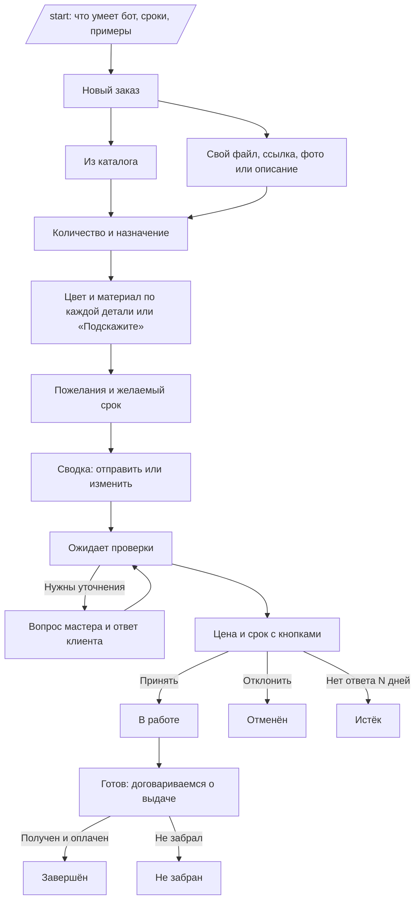
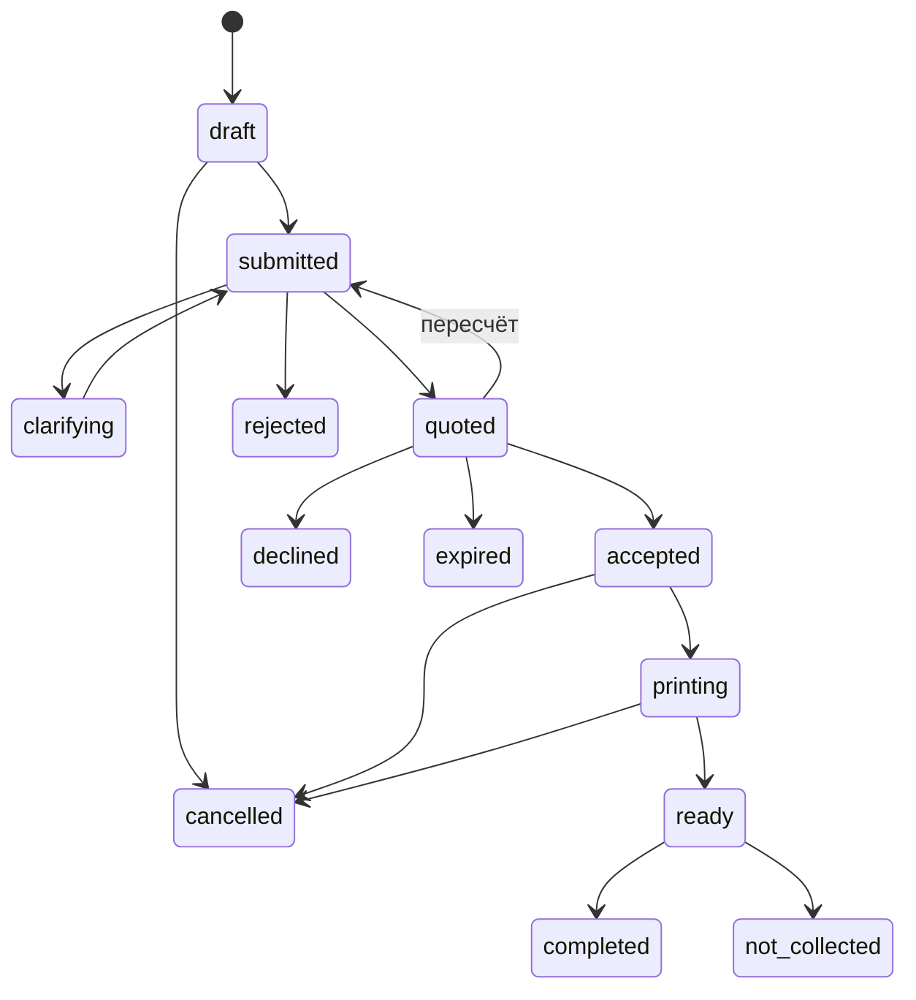

# tdphelper: дизайн продукта

Статус: продуктовые решения приняты 2026-10-30, ждёт итоговой проверки. Код по этому документу ещё не писался. План первого этапа: [2026-10-30-stage-1-foundation.md](2026-10-30-stage-1-foundation.md).

## Принятые решения

| Вопрос | Решение | Что из этого следует |
|---|---|---|
| Что выбирает клиент | Всё вместе: каталог, файл, ссылка на популярные платформы, описание | Каталог входит в основную версию, а не откладывается |
| Оборудование | Один Bambu Lab X2D с AMS, инженерные пластики | Ставки и запас на брак задаются по материалу; расход поддержек учитывается отдельной строкой |
| Деньги | Рубли, оплата при получении | Предоплаты нет, поэтому отказ от заказа после печати нужно отслеживать |
| Размещение | Свой VPS и домен, Mini App на поддомене | Домен и HTTPS готовы к этапу 3, параметры VPS ещё нужно проверить |
| Выдача | По умолчанию самовывоз, доставка по договорённости, адрес после договорённости | Адрес не показывается заранее и не хранится в настройках, мастер пишет его в заказе |

## Суть

Telegram-бот для одного исполнителя 3D-печати (дальше «мастер») и его клиентов.

- **Клиент** описывает, что напечатать и какими цветами, получает цену и подтверждает заказ.
- **Мастер** проверяет заказ, считает себестоимость и цену, ведёт заказ до выдачи и видит остатки филамента.

## Главные выводы из изучения темы

1. **Цену нельзя посчитать в момент заказа.** Она зависит от граммов и часов, а их даёт слайсер уже после того, как мастер увидел модель. Поэтому автоматика не называет цену клиенту: она подсказывает её мастеру. Это совпадает с твоей идеей ревью.
2. **Клиент не должен думать про граммы.** Он выбирает цвет и материал или назначение изделия. Граммы, часы и себестоимость видит только мастер.
3. **Остаток считается по катушкам, а цвет выбирается по филаменту.** Это разные сущности. Филамент: PLA Bambu чёрный. Катушка: конкретный экземпляр с остатком в граммах.
4. **Счётчик остатков будет расходиться с реальностью.** Причины: неудачные печати, промывка при смене цвета, подложки. Нужна быстрая сверка по весам: мастер вводит вес катушки, бот вычитает вес пустой катушки. Без него остаток завышается на 120–250 г в зависимости от бренда.
5. **Файлы не нужно скачивать на сервер.** Обычный Bot API позволяет боту скачивать файлы только до 20 МБ, а STL часто больше. Боту это не мешает: он сохраняет `file_id` и пересылает файл мастеру в Telegram. Сервер файлы не хранит и не разбирает.
6. **Mini App подходит для админки.** Он открывается внутри Telegram, сам опознаёт пользователя, поддерживает тему Telegram и нативные кнопки, но требует публичный HTTPS-адрес.
7. **Инженерные пластики стоят дороже не только за килограмм.** Они дольше сохнут, чаще дают брак и изнашивают сопло, особенно с углеволокном. Поэтому ставка принтера и запас на брак зависят от материала. Клиент часто не знает, что ему нужно, поэтому бот спрашивает и о назначении детали.
8. **X2D задаёт ограничения.** По данным Bambu Lab, это сопло до 300 °C, активный нагрев камеры до 65 °C, стол до 120 °C; область печати около 256 × 256 × 260 мм, а в режиме двух сопел меньше. Второе сопло служит для поддержек, но черновая башня всё равно печатается, так что расход на неё и поддержки нужно вводить из слайсера. Возможность печати конкретным материалом и габариты решает мастер при проверке.
9. **Оплата при получении создаёт риск.** Клиент может не забрать готовое изделие, а материал и время уже потрачены. Нужны явное подтверждение обязательства, напоминания и учёт незабранных заказов.

## Роли

| Роль | Что может | Как определяется |
|---|---|---|
| Клиент | Создавать свои заказы, видеть только их, принимать или отклонять цену | Любой пользователь Telegram |
| Мастер | Всё, включая филамент, цены и настройки | `From.ID` входит в `ADMIN_IDS` |

## Клиентский путь



Правила поведения:

- На каждом шаге есть «Назад» и «Отмена». `/cancel` работает всегда, черновик живёт 7 дней.
- На недопустимый ввод бот объясняет, что ожидал, и не сбрасывает прогресс.
- Клиент видит только цвета, которые сейчас есть, без граммов. Если нужного нет, есть кнопка «Другой цвет»: цвет описывается текстом, и мастер решает сам.
- `/orders` показывает заказы клиента и их статус. О каждой смене статуса бот пишет сам.
- Источник модели можно выбрать любой. Ссылки MakerWorld, Printables, Thingiverse, Cults3D и Thangs распознаются и подписываются платформой. Другая ссылка тоже принимается, но мастер увидит пометку. Сервер ссылки не открывает.
- Файл любого размера, который принял Telegram, уходит мастеру через `file_id`.
- Из каталога заказ идёт тем же путём и тоже проходит проверку мастера. У позиции может быть подпись «ориентировочно от N ₽», но окончательную цену называет только мастер.
- Материал выбирается из доступных. Вариант «Подскажите» спрашивает об условиях работы детали: улица, нагрев, нагрузка, контакт с влагой. Выбор материала остаётся за мастером.
- Кнопка «Написать мастеру» есть в каждом активном заказе, сообщения привязаны к заказу. Свободная переписка вне заказа не поддерживается.
- Выдача обсуждается в заказе. По умолчанию самовывоз, адрес мастер пишет сам после договорённости. Если договорились о доставке, её стоимость добавляется в заказ отдельной строкой.

Сообщение с ценой:

```
Заказ #128 проверен
Держатель для наушников, 2 шт.
Цвета: чёрный PLA, красный PLA

Стоимость: 900 ₽, оплата при получении
Срок: 3 дня после подтверждения
Получение: самовывоз, адрес пришлю после подтверждения
Цена действует 5 дней

Подтверждая заказ, вы соглашаетесь забрать и оплатить его.

[Подтвердить] [Задать вопрос] [Отказаться]
```

## Путь мастера

1. Приходит уведомление: «Новый заказ #128» с кнопками «Открыть» (Mini App) и «Задать вопрос».
2. Мастер смотрит модель, нарезает её в слайсере и вводит граммы по каждому филаменту, включая поддержки и черновую башню, часы печати и минуты ручной работы. Для позиции каталога поля заполнены заранее.
3. Калькулятор показывает себестоимость и рекомендуемую цену, а также предупреждает, если филамента не хватает.
4. Мастер при необходимости меняет цену, указывает срок и отправляет клиенту.
5. После подтверждения граммы резервируются. После завершения печати фактический расход списывается с катушек.
6. Когда заказ готов, мастер договаривается с клиентом о выдаче и пишет адрес. При получении отмечает оплату, и заказ завершается. Если заказ не забрали, бот напоминает клиенту через 3 и 7 дней, затем сообщает мастеру, а тот отмечает «Не забран».

### Экраны админки (Mini App)

| Экран | Содержимое |
|---|---|
| Заказы | Вкладки по статусам, счётчик ожидающих проверки, карточка заказа |
| Карточка заказа | Запрос клиента, калькулятор, переписка, смена статуса, расход филамента |
| Филамент | Цвет, материал, бренд, цена за кг, свободный остаток, предупреждение о малом остатке |
| Катушка | Остаток, история списаний, быстрая сверка по весам |
| Каталог | Позиции: название, фото, описание, доступные материалы, заранее заполненные граммы и часы |
| Материалы | PLA, PETG, ABS, ASA, PA и другие: ставка принтера и запас на брак |
| Настройки | Ставка ручной работы, наценка, минимальный заказ, округление |

Для заказов на ходу те же основные действия доступны кнопками в боте: открыть заказ, задать вопрос и сменить статус.

## Расчёт цены

```
материал    = Σ (граммы × цена за кг / 1000)
машина      = часы × ставка принтера
работа      = минуты / 60 × ставка мастера
запас       = (материал + машина) × брак / (1 − брак)
себестоимость = материал + машина + работа + запас
цена        = max(себестоимость × (1 + наценка), минимальный заказ), округление вверх
итого       = цена + доставка, если договорились
```

Ставка принтера и `брак` берутся по материалу. Если в заказе несколько материалов, расчёт использует самые высокие значения среди них, а мастер может их изменить.

Пример с условными ставками: 120 г по 2000 ₽/кг, 6 ч по 30 ₽, 20 мин по 600 ₽/ч, брак 10%, наценка 30%, округление до 50 ₽.
Материал 240, машина 180, работа 200, запас 46,67. Себестоимость 666,67, с наценкой 866,67, итоговая цена **900 ₽**.

Правила:

- Цена в калькуляторе только рекомендация: мастер всегда может её изменить.
- В заказе сохраняются снимок ставок и итоговый расчёт, чтобы смена настроек не меняла старые заказы.
- Запас считается только на материал и машинное время: ручная работа при браке обычно не повторяется целиком.
- Деньги хранятся в копейках, вес в целых граммах. Никаких `float`.

## Учёт филамента

Данные: **филамент** (материал, цвет, бренд, цена за кг, скрыт или нет) и **катушка** (филамент, начальный вес, вес пустой катушки, остаток, статус).

| Событие | Что происходит |
|---|---|
| Купил катушку | Добавляется катушка с ценой и весом |
| Клиент подтвердил цену | Граммы резервируются: свободный остаток уменьшается, физический нет |
| Печать завершена | Мастер подтверждает или правит расход, резерв снимается, граммы списываются |
| Неудачная печать | Расход списывается с пометкой «брак» и привязкой к заказу |
| Личная печать | Списание без заказа |
| Взвешивание | Остаток = вес − вес пустой катушки, разница пишется в журнал как корректировка |
| Заказ отменён | Резерв снимается |
| Свободный остаток ниже порога | Мастер получает уведомление один раз за снижение |

Свободный остаток = сумма остатков катушек − резервы. Все изменения идут через журнал движений, поэтому историю всегда можно восстановить. Списание идёт с катушки, выбранной мастером; по умолчанию с уже начатой.

## Статусы заказа



`completed` означает, что заказ получен и оплачен. `not_collected` оставляет списанный расход и убыток в статистике, а заказы клиента с этим статусом видны мастеру при следующей проверке.

Переходы проверяются в `internal/service`. Повторное нажатие старой кнопки ничего не ломает: бот отвечает актуальным статусом. Неудачная печать не отдельный статус, а событие расхода внутри `printing`.

## Пользовательские истории

### Клиент

| № | История | Критерии приёмки |
|---|---|---|
| К1 | Хочу понять, что умеет бот, чтобы решить, заказывать ли | `/start` показывает описание и кнопку «Новый заказ» |
| К2 | Хочу отправить файл, ссылку, фото или описание | Принимается любой вариант; файл больше 20 МБ доходит до мастера; ссылка подписана платформой |
| К3 | Хочу выбрать цвет и материал для каждой детали | Показаны только доступные цвета; можно описать другой цвет текстом |
| К9 | Хочу выбрать готовую модель из каталога | Список с фото и описанием, доступны только разрешённые материалы и цвета |
| К10 | Хочу получить совет по материалу | «Подскажите» спрашивает об условиях работы детали и передаёт ответы мастеру |
| К11 | Хочу знать условия получения и оплаты | В сообщении с ценой указаны оплата при получении и способ выдачи; адрес приходит после договорённости |
| К4 | Хочу проверить заказ перед отправкой | Сводка с возможностью изменить любое поле |
| К5 | Хочу получить цену и срок и решить сам | Кнопки подтверждения и отказа; ответить можно, пока цена действует |
| К6 | Хочу задать вопрос по цене | Вопрос привязывается к заказу и приходит мастеру |
| К7 | Хочу видеть свои заказы и их статус | `/orders` показывает только свои заказы; о смене статуса приходит сообщение |
| К8 | Хочу отменить заказ, пока печать не началась | Отмена снимает резерв и уведомляет мастера |

### Мастер

| № | История | Критерии приёмки |
|---|---|---|
| М1 | Хочу сразу узнавать о новом заказе | Уведомление со ссылкой на заказ в Mini App |
| М2 | Хочу быстро считать цену по данным слайсера | Граммы, часы и минуты дают себестоимость и рекомендуемую цену |
| М3 | Хочу менять цену перед отправкой | Итоговая цена может отличаться от расчётной, обе сохраняются |
| М4 | Хочу уточнить детали до расчёта | Вопрос приходит клиенту, ответ возвращается в заказ |
| М5 | Хочу добавлять и скрывать филамент | Скрытый цвет не виден клиентам, старые заказы не меняются |
| М6 | Хочу видеть реальный остаток | Показаны физический и свободный остаток и история движений |
| М7 | Хочу сверять остаток по весам | Ввод веса пересчитывает остаток, разница попадает в журнал |
| М8 | Хочу учитывать брак и личную печать | Списание без клиента и с типом причины |
| М9 | Хочу знать, что филамент заканчивается | Одно уведомление при пересечении порога |
| М10 | Хочу видеть прибыль по заказам | Карточка показывает себестоимость, цену и разницу |
| М11 | Хочу вести каталог | Добавляю, скрываю и меняю позиции; граммы и часы подставляются в калькулятор |
| М12 | Хочу задавать условия по материалам | Ставка принтера и брак по материалу попадают в расчёт и снимок заказа |
| М13 | Хочу согласовать выдачу | Пишу адрес или условия в заказе, могу добавить стоимость доставки |
| М14 | Хочу отмечать оплату и незабранные заказы | Получение и оплата завершают заказ; незабранный остаётся в статистике как убыток |

## Архитектура

- **Один Go-бинарник:** бот на long polling и HTTP-сервер с JSON API и статикой Mini App через `go:embed`.
- **Клиентская часть в боте, админка в Mini App.** Клиенту не нужно ничего осваивать, а мастеру удобнее работать с таблицами и формами на веб-экране.
- **Хранилище SQLite.** Один мастер, небольшая нагрузка, простой бэкап одним файлом. Заказы, катушки и состояние диалогов переживают перезапуск. Доступ через интерфейсы в `internal/service`, чтобы при росте перейти на Postgres. Понадобится новая зависимость, например `modernc.org/sqlite` без CGO.
- **Фронтенд:** Vite + Preact, тема из CSS-переменных Telegram (`--tg-theme-*`), `BackButton` и `MainButton`.

### Безопасность

- Каждый запрос к API проверяет подпись `initData` (HMAC-SHA-256) и свежесть `auth_date`, затем сравнивает пользователя с `ADMIN_IDS`. Скрытия кнопок недостаточно.
- Клиентские обработчики проверяют, что заказ принадлежит `From.ID`.
- Текст клиента экранируется при выводе в HTML. Сервер не скачивает файлы и не открывает ссылки клиентов, что исключает запросы к внутренним адресам VPS. Мастеру ссылка показывается как есть, с платформой или пометкой.
- В логах нет токена и текста заказов.
- Собираем минимум данных: Telegram ID, имя и содержание заказа. Для адреса нет отдельного поля, но он может оказаться в переписке, поэтому текст сообщений удаляется через 90 дней после закрытия заказа. Перед запуском на реальных клиентах стоит проверить требования к персональным данным.

## Этапы

| Этап | Результат | Что проверяем |
|---|---|---|
| 1. Основа | SQLite, миграции, материалы, филамент и катушки, настройки, калькулятор как чистая функция | Табличные тесты формулы и журнала |
| 2. Заказ в боте | Полный клиентский путь без каталога: файлы, ссылки, ответ с ценой, сообщения в заказе | Заказ проходит от `/start` до завершения |
| 3. Mini App | Развёртывание на поддомене, заказы, калькулятор, филамент, сверка по весам | Проверка `initData`, работа на телефоне |
| 4. Каталог | Управление в Mini App, выбор в боте, подстановка в калькулятор | Заказ из каталога проходит тем же путём |
| 5. Учёт в заказах | Резерв, списание, брак, пороговые уведомления, незабранные заказы | Остаток сходится с журналом после отмен и брака |
| 6. Развитие | Статистика, онлайн-оплата, интеграция с принтером | По необходимости |

Этап 2 можно использовать сразу: до Mini App мастер вводит цену кнопками в боте. Так проверим сценарий на реальных заказах до вложений в веб-интерфейс.

## Что не делаем в первой версии

Онлайн-оплату и предоплату, разбор STL и автоматический расчёт граммов, скачивание файлов на сервер, интеграцию со слайсером и принтером, расчёт и оформление доставки в боте, несколько мастеров и принтеров.

## Что проверить позже

- Какие материалы реально предлагать клиентам: заполняется мастером на этапе 1.
- Хватает ли VPS и какая на нём ОС: перед этапом 3.
- Нужна ли предоплата за дорогие заказы: решить по опыту незабранных заказов.

## Источники

- Расчёт цены: [Filaquote](https://filaquote.com/guides/how-to-calculate-3d-printing-cost/), [PrintNexus](https://printnexus.io/blog/how-to-price-3d-prints), [Printie](https://printie.com/blog/2026-01-31-how-to-price-3d-prints), [Omni Calculator](https://www.omnicalculator.com/other/3d-printing)
- Учёт катушек: [Spoolman, пустая катушка](https://github.com/Donkie/Spoolman/pull/1164), [Spoolman-light](https://github.com/crjeder/Spoolman-light), [3D Print Pricing](https://3dprintpricing.pro/en/blog/how-much-filament-is-left-on-a-spool), [обзор Spoolman](https://blog.octoeverywhere.com/spoolman-3d-printer-filament-inventory-management-setup-guide/)
- Telegram: [Mini Apps](https://core.telegram.org/bots/webapps), [Bot API](https://core.telegram.org/bots/api), [Bots FAQ](https://core.telegram.org/bots/faq)
- Принтер: [Bambu Lab X2D](https://bambulab.com/en-us/x2d), [обзор CNC Kitchen](https://www.cnckitchen.com/blog/bambu-lab-x2d-review-affordable-dual-nozzle-printing-with-a-catch), [характеристики Gigaparts](https://www.gigaparts.com/bambu-lab-x2d-3d-printer-combo.html)
